<p align="center">
  <a href="https://www.unfantasmaenelsistema.com"></a>
</p>

<h1 align="center">VirtLab</h1>

<p align="center">
  <b>El Administrador de VirtualBox 7.1 dentro del navegador, con una red que se calcula paquete a paquete</b><br>
  Crea e instala máquinas · NAT, Red NAT, puente, red interna y solo anfitrión · Consolas Linux, Windows y del anfitrión · VBoxManage · 15 laboratorios que se corrigen solos
</p>

<p align="center">
  <a href="https://unfantasmaenelsistema.github.io/VirtLab/"><b>▶ Abrir en el navegador</b></a> ·
  <a href="https://unfantasmaenelsistema.github.io/VirtLab/virtlab-offline.html"><b>⬇ Versión offline (un solo .html)</b></a> ·
  <a href="#los-15-laboratorios">Laboratorios</a> ·
  <a href="#en-el-aula">En el aula</a> ·
  <a href="#desarrollo">Desarrollo</a> ·
  <a href="https://www.unfantasmaenelsistema.com">unfantasmaenelsistema.com</a> ·
  <a href="LICENSE">MIT</a>
</p>

<p align="center">
  
  
  
  
  
  
</p>

<p align="center">
  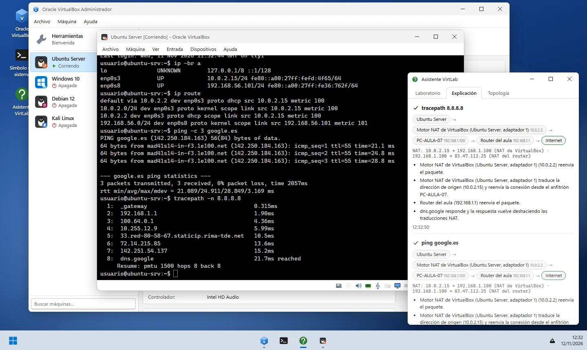
</p>

VirtLab reproduce el **Administrador de Oracle VirtualBox 7.1** (en español, con su aspecto en Windows 11) para practicar virtualización y redes sin instalar nada ni gastar RAM: el alumnado crea máquinas con el asistente, monta ISO, instala Ubuntu, Debian, Kali o Windows, toma instantáneas, clona, exporta servicios virtualizados y, sobre todo, **entiende las redes virtuales**: por qué una VM en NAT tiene Internet pero nadie la ve, por qué un Windows recién instalado no contesta al ping o por qué dos clones se pelean por la misma IP.

Nada de lo que ocurre en la red está escrito de antemano: cada `ping`, `traceroute`, `curl`, `ssh`, `nmap` o `dhclient` recorre una topología real (segmentos, tablas de rutas, ARP, NAT, cortafuegos, reenvío de puertos, DHCP y DNS). Si una configuración funcionaría en un VirtualBox de verdad, funciona en VirtLab; si fallaría, falla con el mismo mensaje.

> [!NOTE]
> Todo funciona en el navegador, sin servidor ni cuentas. El laboratorio (máquinas, discos, redes, instantáneas y progreso) se guarda en el `localStorage` del propio equipo y se puede exportar e importar como `.json` o compartir con un enlace.

> [!IMPORTANT]
> VirtLab es un proyecto educativo independiente: no está afiliado, patrocinado ni respaldado por Oracle. Oracle y VirtualBox son marcas registradas de Oracle y/o sus filiales; Windows es marca de Microsoft; Ubuntu, de Canonical; Debian, de SPI; Kali Linux, de OffSec. Los iconos son dibujos propios.

## Índice

- [Qué se puede hacer](#qué-se-puede-hacer)
- [Capturas](#capturas)
- [Las redes de VirtualBox, de verdad](#las-redes-de-virtualbox-de-verdad)
- [Los 15 laboratorios](#los-15-laboratorios)
- [Las consolas](#las-consolas)
- [Máquinas de ejemplo](#máquinas-de-ejemplo)
- [En el aula](#en-el-aula)
- [Desarrollo](#desarrollo)
- [Estructura](#estructura)
- [Novedades de la v2](#novedades-de-la-v2)
- [Créditos y licencia](#créditos-y-licencia)

## Qué se puede hacer

| Área | Lo que reproduce VirtLab |
| :--- | :--- |
| **Administrador** | Lista de máquinas con estado, menú ≡ de herramientas (Detalles, Instantáneas, Registros, Actividad), barra Nueva · Añadir · Configuración · Descartar · Iniciar ▾ (normal, sin interfaz, desacoplado), previsualización en vivo, menús Archivo / Máquina / Ayuda y menú contextual. |
| **Asistentes** | *Crear máquina virtual* (nombre, ISO con detección del sistema, instalación desatendida con `vboxuser`/`changeme`, hardware con zonas verde-amarilla-roja, disco VDI dinámico o reservado, resumen y **modo experto**), *Clonar* (política de MAC, completa o enlazada, instantáneas), *Exportar* e *Importar servicio virtualizado* (.ova), *Crear disco duro virtual* (VDI/VHD/VMDK). |
| **Configuración** | General, Sistema (RAM, orden de arranque, chipset, TPM, EFI, arranque seguro, CPU, PAE, VT-x anidado, paravirtualización), Pantalla, Almacenamiento (controladores IDE/SATA/SCSI/NVMe, unidades ópticas y discos, selectores de medios), Audio, **Red** (4 adaptadores, 8 modos, tipo de tarjeta, modo promiscuo, MAC, cable conectado, **reenvío de puertos**), Puertos serie, USB, Carpetas compartidas e Interfaz. Avisos de «Configuración no válida detectada» y ajustes bloqueados con la máquina encendida, como en el original. |
| **Ventana de la VM** | BIOS/UEFI, menú de arranque **F12**, «FATAL: No bootable medium found!», PXE, menú de la ISO, instalador (Ubuntu, Debian, Kali, Windows 10/11/Server 2022 con comprobación de requisitos de Windows 11), arranque de systemd con *wait-online*, inicio de sesión en tty o pantalla de bloqueo de Windows, escritorio de Windows con CMD, CMD de administrador (UAC) y PowerShell. Menús Máquina, Ver, Entrada y Dispositivos (ISO, cable de red, Guest Additions, portapapeles) y barra de estado con indicadores. |
| **Herramientas** | Administrador de medios (discos, ISO, disquetes; liberar, copiar, mover, ampliar), Administrador de red (redes solo anfitrión con su servidor DHCP y **Redes NAT** con reenvío de puertos), Actividad (CPU y red por máquina) y registros `VBox.log`. |
| **Ciclo de vida** | Guardar estado, apagado ACPI, apagar, pausar, reiniciar, descartar estado guardado, **instantáneas** en caliente o en frío con árbol y restauración, eliminar («Eliminar todos los archivos» / «Quitar solo») y volver a añadir. |
| **Anfitrión** | Escritorio Windows 11 con barra de tareas, consola del anfitrión (CMD/PowerShell) con `ping`, `tracert`, `ssh`, `curl` y **VBoxManage**, y ajustes de red del propio PC (cable, Wi-Fi, firewall). |
| **Didáctica** | **Asistente VirtLab** con la explicación salto a salto de cada orden de red, topología dibujada en vivo, 15 laboratorios autocorregidos con pistas y códigos de verificación, modo instructor con averías, enlaces de escenario y modo examen. |

## Capturas

<p align="center">
  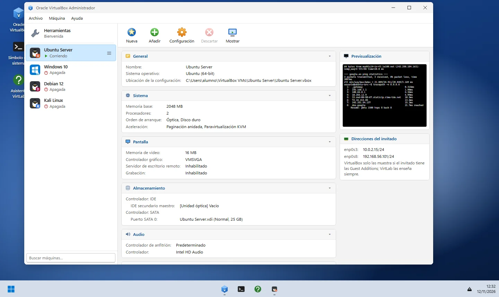
  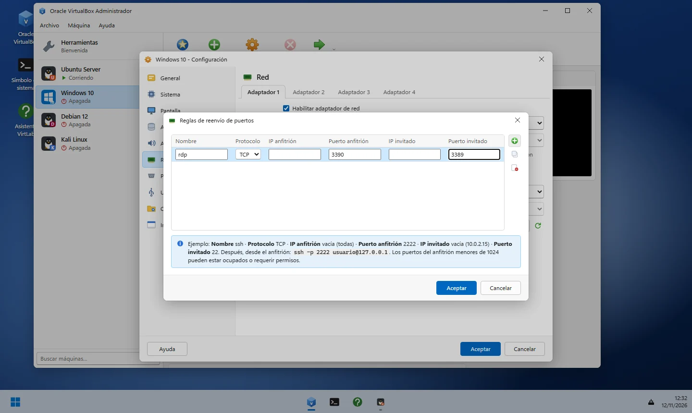
</p>
<p align="center">
  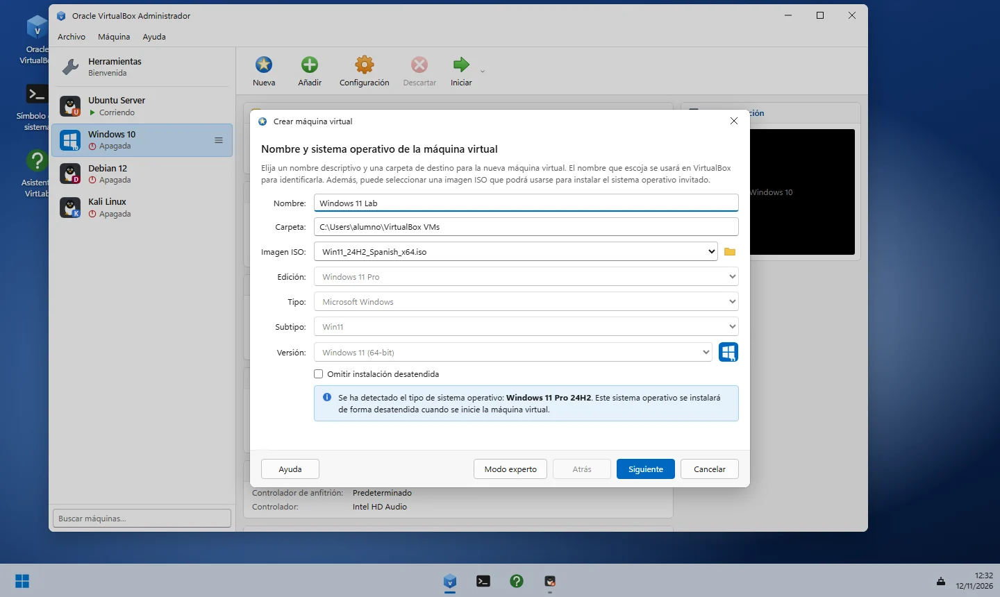
  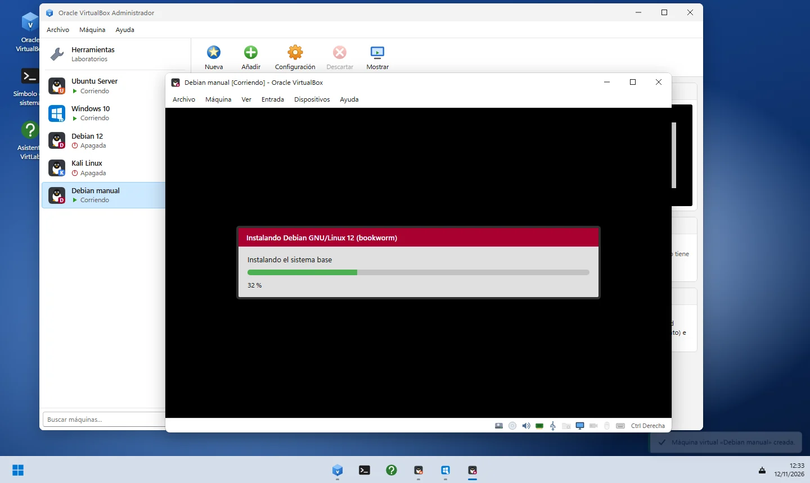
</p>
<p align="center">
  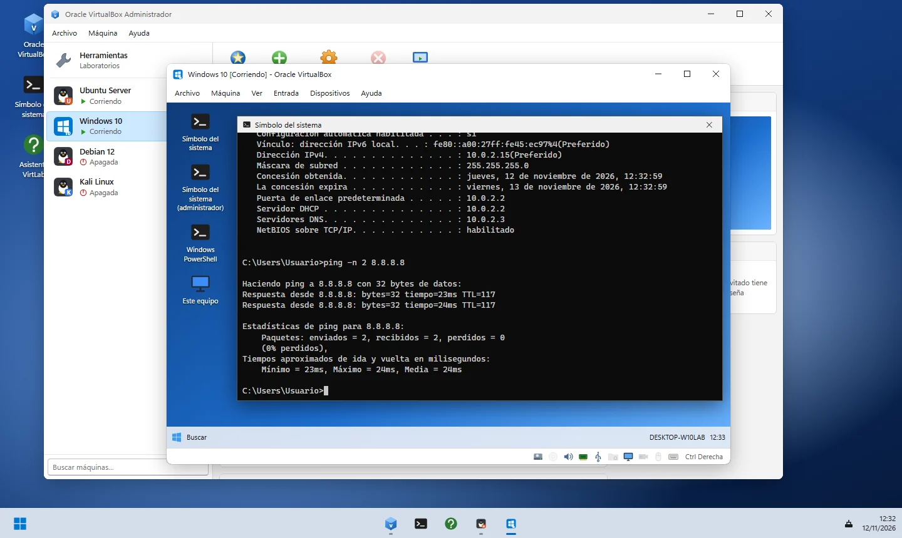
  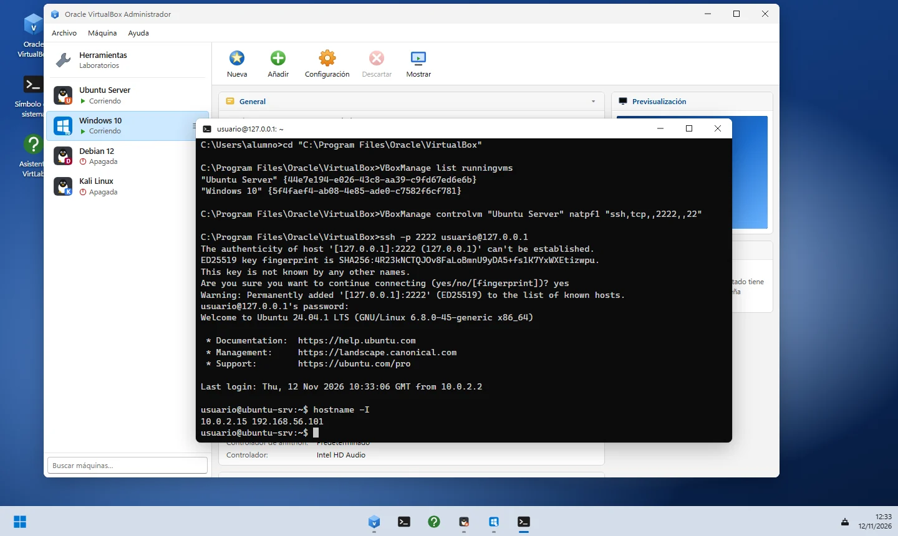
</p>
<p align="center">
  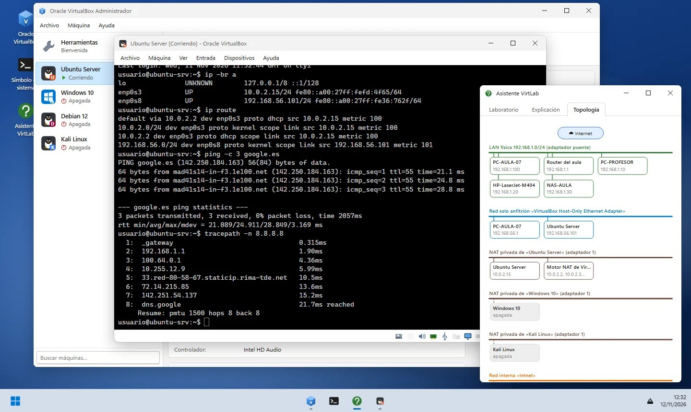
  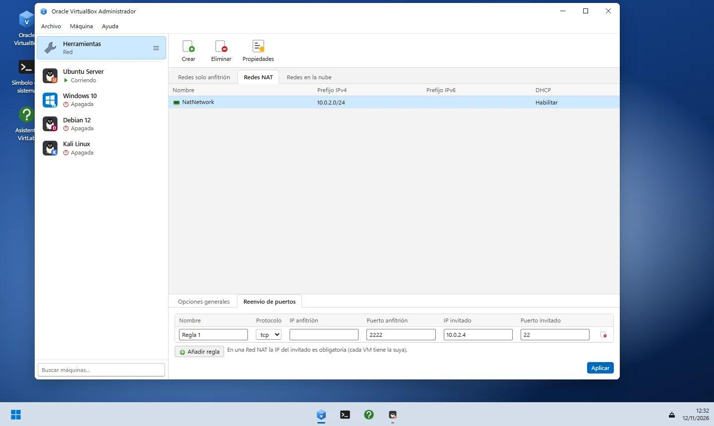
</p>
<p align="center">
  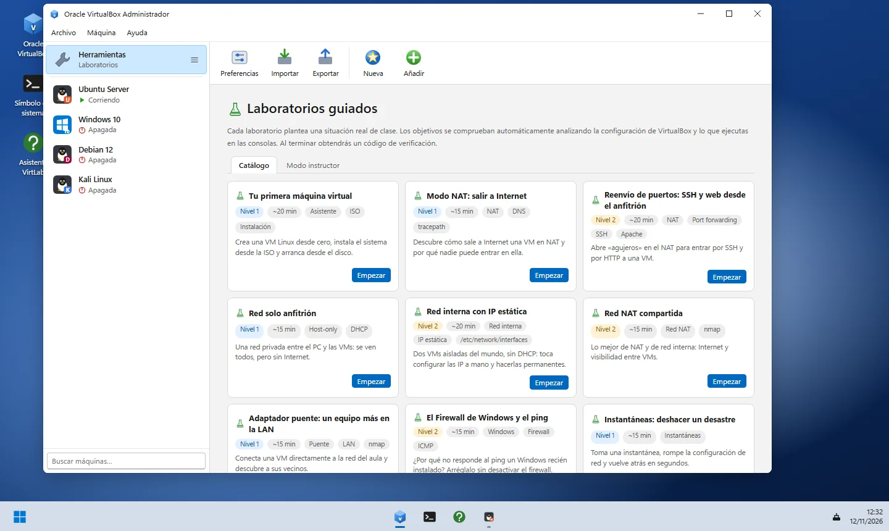
  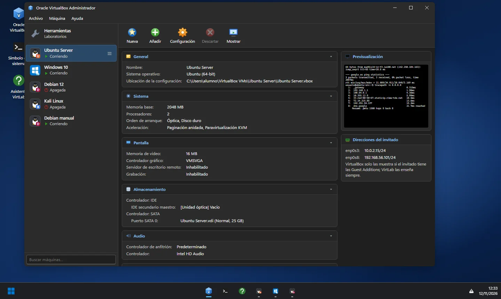
</p>

## Las redes de VirtualBox, de verdad

Cada adaptador de cada máquina encendida se conecta a un **segmento**; el anfitrión, el router del aula, la impresora y el NAS también son nodos con sus interfaces, sus rutas y su cortafuegos. Un paquete se enruta como en la realidad: busca la ruta más específica, resuelve el siguiente salto por ARP en ese segmento, atraviesa routers (si reenvían), sufre las traducciones NAT y, al llegar, pasa por el cortafuegos y necesita una ruta de vuelta.

| Modo | VM ↔ VM | VM → anfitrión | Anfitrión → VM | VM → Internet | Direcciones |
| :--- | :---: | :---: | :---: | :---: | :--- |
| **NAT** | ❌ (cada VM tiene su propio NAT) | ✅ | Solo con reenvío de puertos | ✅ | 10.0.2.15 · pasarela 10.0.2.2 · DNS 10.0.2.3 (adaptador 2: 10.0.3.x…) |
| **Red NAT** | ✅ misma red | ✅ | Solo con reenvío de puertos | ✅ | 10.0.2.4… · pasarela 10.0.2.1 · DHCP 10.0.2.3 |
| **Adaptador puente** | ✅ | ✅ | ✅ | ✅ | Las reparte el router del aula (192.168.1.101–199) |
| **Red interna** | ✅ mismo nombre | ❌ | ❌ | ❌ | Sin DHCP: IP estática (Windows se pone APIPA 169.254.x.x) |
| **Solo anfitrión** | ✅ | ✅ (192.168.56.1) | ✅ | ❌ | DHCP 192.168.56.100 → 192.168.56.101… sin puerta de enlace |
| **No conectado** | — | — | — | — | La tarjeta existe pero no hay enlace (`NO-CARRIER`) |

Detalles que se comportan como en un equipo real:

- **DHCP con concesiones por MAC**: los clones que conservan la MAC reciben la misma IP → conflicto, `(DUP!)` y respuestas aleatorias.
- **Motor NAT de VirtualBox**: solo acepta tráfico con origen en su red; un router Linux sin `MASQUERADE` no consigue sacar a Internet a su red interna.
- **Cortafuegos**: Windows bloquea el eco ICMP entrante por defecto (y no contesta a puertos cerrados); `ufw` deja pasar ICMP; `iptables` y `/etc/iptables/rules.v4` se aplican de verdad.
- **Configuración persistente frente a temporal**: `ip addr add` se pierde al reiniciar; netplan (Ubuntu), `/etc/network/interfaces` (Debian) o `netsh` (Windows) no. netplan valida el YAML (tabuladores, sangría, `gateway4` obsoleto).
- **DNS**: proxy DNS del NAT, `systemd-resolved` en Ubuntu (`127.0.0.53`), `/etc/resolv.conf` en Debian, NXDOMAIN, servidores inalcanzables…
- **Cable desconectado**: `NO-CARRIER`, «medios desconectados», `Network is unreachable` / «Error general», y renovación automática al reconectar.
- **SSH**: huella del servidor la primera vez, aviso **REMOTE HOST IDENTIFICATION HAS CHANGED** si otra máquina ocupa la IP, contraseñas y sesiones anidadas.

## Los 15 laboratorios

Se abren en **Herramientas › Laboratorios** (o en el Asistente). Los objetivos se comprueban solos analizando la configuración de VirtualBox y lo que se ejecuta en las consolas; cada uno tiene su pista y, al terminar, un código de verificación `flag{…}` para el profesorado.

| # | Laboratorio | Nivel | Qué se aprende |
| :---: | :--- | :---: | :--- |
| 1 | Tu primera máquina virtual | 1 | Asistente, disco VDI dinámico, instalación (desatendida o manual) y arranque sin ISO |
| 2 | Modo NAT: salir a Internet | 1 | 10.0.2.15/10.0.2.2/10.0.2.3, DNS, `tracepath` y por qué el anfitrión no ve la VM |
| 3 | Reenvío de puertos: SSH y web | 2 | Reglas NAT 2222→22 y 8080→80, `ssh -p`, Apache y `curl` desde el anfitrión |
| 4 | Red solo anfitrión | 1 | DHCP de VirtualBox, ping anfitrión ↔ VM y VM ↔ VM sin Internet |
| 5 | Red interna con IP estática | 2 | `ip addr`, máscara, `/etc/network/interfaces` y persistencia tras reiniciar |
| 6 | Red NAT compartida | 2 | Crear una Red NAT, visibilidad entre VMs con Internet, `nmap -sn` |
| 7 | Adaptador puente | 1 | IP del router del aula, ping desde el anfitrión, descubrir impresora y NAS |
| 8 | El Firewall de Windows y el ping | 2 | Regla de eco ICMPv4 con `netsh` sin desactivar el cortafuegos |
| 9 | Instantáneas: deshacer un desastre | 1 | Instantánea en caliente, romper netplan, restaurar |
| 10 | Clonar sin conflictos de MAC | 2 | Política de MAC al clonar, IP duplicadas y cómo arreglarlas |
| 11 | Router Linux con MASQUERADE | 3 | Dos adaptadores, `ip_forward`, `iptables -t nat`, puerta de enlace y DNS del cliente |
| 12 | Servidor DHCP propio | 3 | `isc-dhcp-server` en una red interna: `INTERFACESv4`, `subnet`, `dhclient` |
| 13 | Administrar con VBoxManage | 2 | `list`, `startvm --type headless`, `natpf`, `snapshot`, `controlvm` |
| 14 | Guest Additions y carpeta compartida | 2 | Compilar los módulos (gcc, cabeceras), `vboxsf`, grupo y `/media/sf_*` |
| 15 | Diagnóstico: cuatro averías | 3 | Cable, modo de red, DHCP desactivado y DNS erróneo, de abajo arriba |

## Las consolas

**Linux** (Ubuntu 24.04, Debian 12 y Kali, con su prompt, su `motd` y los paquetes que trae cada uno): `ip a|link|route|neigh` (con `add`, `del`, `flush`, `set up/down`, `-br`, `-4`), `ping`, `tracepath`, `traceroute`, `dhclient [-v] [-r]`, `networkctl`, `netplan apply|try|get`, `ifup`/`ifdown`, `nmcli`, `resolvectl`, `dig`, `nslookup`, `host`, `curl`, `wget`, `ssh`, `nc`, `nmap`, `ss`, `netstat`, `ifconfig`, `route`, `arp`, `ethtool`, `lspci`, `ufw`, `iptables`, `iptables-save`, `sysctl`, `systemctl`, `journalctl`, `apt`/`apt-get` (necesitan Internet de verdad), `dpkg`, `sudo` (pide la contraseña), `su`, `passwd`, `usermod`, `hostnamectl`, `mount`, `nano` (con ^O y ^X), `cat`, `ls`, `cd`, `grep`, `head`, `tail`, `wc`, `tee`, tuberías, `&&`, `||` y redirecciones… Si una orden no viene instalada, Ubuntu y Kali sugieren el paquete, como en el sistema real.

**Windows** (mensajes en español): `ipconfig [/all /release /renew]`, `ping [-n -t]`, `tracert`, `nslookup`, `arp -a`, `route print`, `netstat`, `getmac`, `netsh interface ip set address|dns`, `netsh advfirewall …`, `curl`, `ssh`, `systeminfo`, `tasklist`, `shutdown`, `whoami` y PowerShell (`Test-NetConnection`, `Get-NetIPAddress`, `Get-NetAdapter`, `New-NetFirewallRule`, `Set-NetFirewallProfile`…). Lo que requiere elevación solo funciona en el CMD de administrador.

**Anfitrión** (PC-AULA-07, Windows 11): todo lo anterior más **VBoxManage**: `list` (vms, runningvms, hostonlyifs, natnets, dhcpservers, hdds, dvds…), `showvminfo [--machinereadable]`, `startvm --type headless`, `controlvm` (poweroff, acpipowerbutton, pause, savestate, setlinkstate, nic, natpf), `modifyvm` (memoria, CPU, `--nic`, `--natpf`, `--cable-connected`, `--macaddress`, `--boot`…), `snapshot`, `clonevm`, `createvm`, `createmedium`, `storageattach`, `unregistervm`, `registervm`, `export`, `import`, `natnetwork`, `hostonlyif`, `dhcpserver` y `guestproperty`. Como en Windows, la carpeta de VirtualBox **no está en el PATH**: hay que entrar en `C:\Program Files\Oracle\VirtualBox` o usar la ruta completa.

## Máquinas de ejemplo

| Máquina | Sistema | Red | Usuario / contraseña |
| :--- | :--- | :--- | :--- |
| Ubuntu Server | Ubuntu 24.04.1 LTS (OpenSSH) | Adaptador 1 NAT · adaptador 2 solo anfitrión | `usuario` / `usuario` |
| Windows 10 | Windows 10 Pro 22H2 | NAT | `Usuario` / `usuario` |
| Debian 12 | Debian 12 mínima | Red interna «intnet» (sin IP) | `usuario` / `usuario` |
| Kali Linux | Kali 2024.3 (nmap, netcat, tcpdump…) | NAT | `kali` / `kali` |

Además hay ISO de Ubuntu Server, Debian, Kali, Windows 10, Windows 11, Windows Server 2022 y las Guest Additions en la carpeta de descargas simulada, y una LAN de aula con router (192.168.1.1), PC del profesor, impresora y NAS.

## En el aula

- **Laboratorios autocorregidos** con códigos de verificación por práctica.
- **Modo instructor** (Herramientas › Laboratorios › Modo instructor): inyecta averías en cualquier máquina (cable desconectado, adaptador no conectado, red interna con otro nombre, netplan roto, DNS erróneo, cortafuegos que bloquea el ping, SSH detenido, ISO olvidada con arranque desde óptica, DHCP de solo anfitrión desactivado, disco fuera del orden de arranque).
- **Escenarios compartibles**: genera un enlace (`#escenario=…`, comprimido) o exporta un `.json` con el laboratorio completo para que el grupo empiece exactamente desde el mismo punto.
- **Modo examen**: oculta pistas y explicaciones del Asistente.
- **Versión offline** en un único `.html` para aulas sin conexión o para entregarla en una memoria USB.

## Desarrollo

Es HTML, CSS y JavaScript (módulos ES) sin frameworks ni dependencias en tiempo de ejecución: se puede servir tal cual.

```bash
python -m http.server 8000
```

```bash
npm install
```

```bash
npm test
```

```bash
npm run build
```

`npm test` ejecuta 20 pruebas con `node --test` sobre el motor de red y los laboratorios (NAT, solo anfitrión, red interna, firewall de Windows, reenvío de puertos, router con MASQUERADE, netplan, apt, MAC duplicadas, Red NAT, VBoxManage, servidor DHCP propio, instantáneas, APIPA, claves SSH, cable desconectado, iptables persistente…). `npm run build` genera `dist/` con la web y `virtlab-offline.html`. El workflow de GitHub Actions pasa las pruebas, construye y publica en GitHub Pages.

## Estructura

```text
├── index.html                 # Escritorio del anfitrión y barra de tareas
├── css/virtlab.css            # Aspecto de VirtualBox 7.1 sobre Windows 11 (claro y oscuro)
├── js/
│   ├── main.js                # Arranque, escenarios por enlace, red del anfitrión
│   ├── store.js               # Estado, máquinas de ejemplo, persistencia y eventos
│   ├── catalog.js             # Sistemas invitados, ISO, tipos de adaptador, Internet simulado
│   ├── guest.js               # Lo que hay en el disco: paquetes, netplan, interfaces, YAML
│   ├── net.js                 # Motor de red: segmentos, rutas, ARP, NAT, DHCP, DNS, cortafuegos
│   ├── vmctl.js               # Arranque, instalación, apagado, instantáneas, clonación, OVA
│   ├── terminal.js            # Terminal con historial, Tab, Ctrl+C, contraseñas y nano
│   ├── labs.js                # Los 15 laboratorios y su corrección automática
│   ├── shell/                 # Bash, CMD/PowerShell, VBoxManage y operaciones de red
│   └── ui/                    # Administrador, configuración, asistentes, ventana de VM, asistente
├── tests/                     # Pruebas con node --test
├── scripts/build.mjs          # dist/ + versión offline de un solo archivo
└── docs/capturas/             # Capturas reales de este README
```

## Novedades de la v2

La primera versión (generada con Google AI Studio) era una única página con una tabla de visibilidad escrita a mano. La v2 es una reescritura completa:

- **Red simulada de verdad** en lugar de reglas fijas: los resultados salen de enrutar el paquete. Corrige mensajes como «DHCPOFFER received from undefined» y casos imposibles (la VM recibía IP sin que la red tuviera DHCP, la red interna daba APIPA en Linux…).
- **Red NAT**, adaptador «No conectado», varias redes solo anfitrión y servidores DHCP configurables, que no existían.
- La ventana de la VM ya no está llena de botones que VirtualBox no tiene: ahora es la ventana real con sus menús y su barra de estado, y el sistema invitado **arranca, se instala y pide usuario y contraseña**.
- Las direcciones se obtienen por DHCP al arrancar (como en un sistema real) en vez de obligar a lanzar `dhclient` siempre.
- Instalación de sistemas desde ISO, instantáneas, clonación con política de MAC, exportación e importación OVA, medios virtuales, VBoxManage y consola del anfitrión.
- Asistente didáctico y laboratorios autocorregidos en lugar del «Modo Dios» con banderas fijas.
- Se elimina el andamiaje de React, Vite y Gemini que no se usaba.

## Créditos y licencia

Creado por **[Un Fantasma en el Sistema](https://www.unfantasmaenelsistema.com)** para la formación práctica en virtualización, sistemas y redes.

Publicado bajo [licencia MIT](LICENSE).
