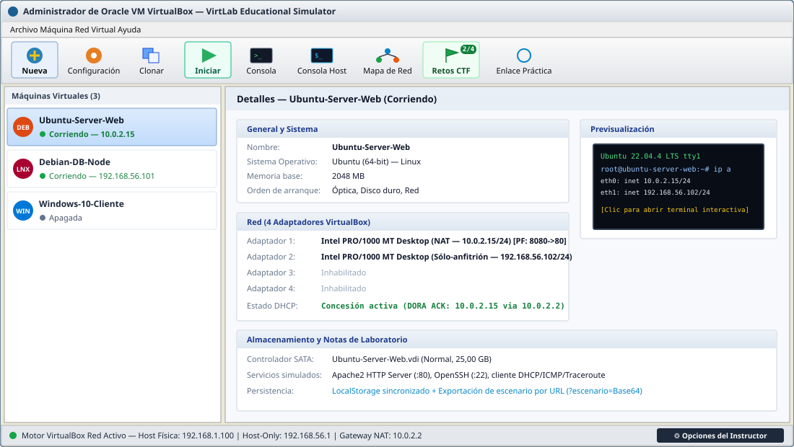
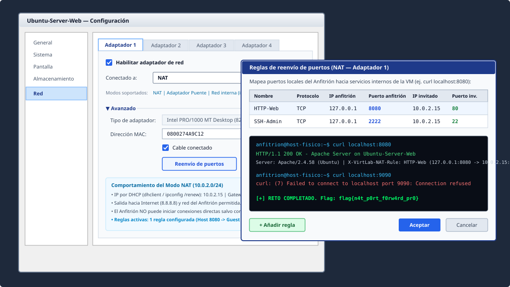
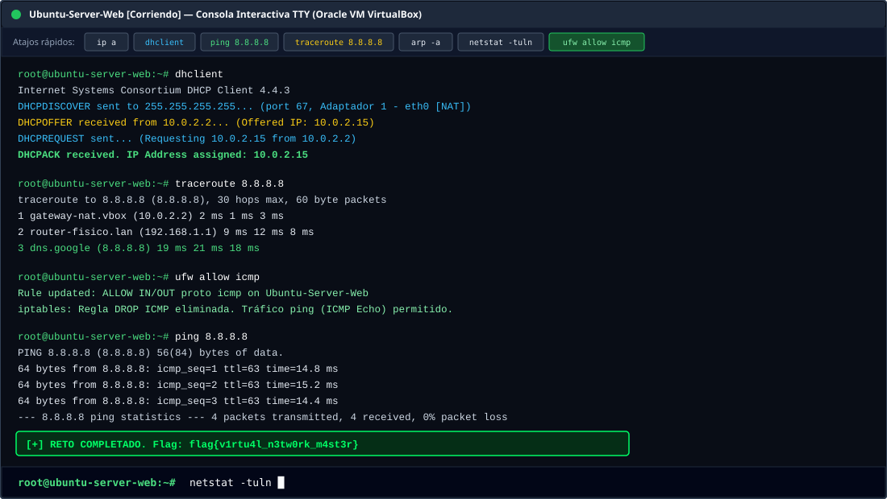
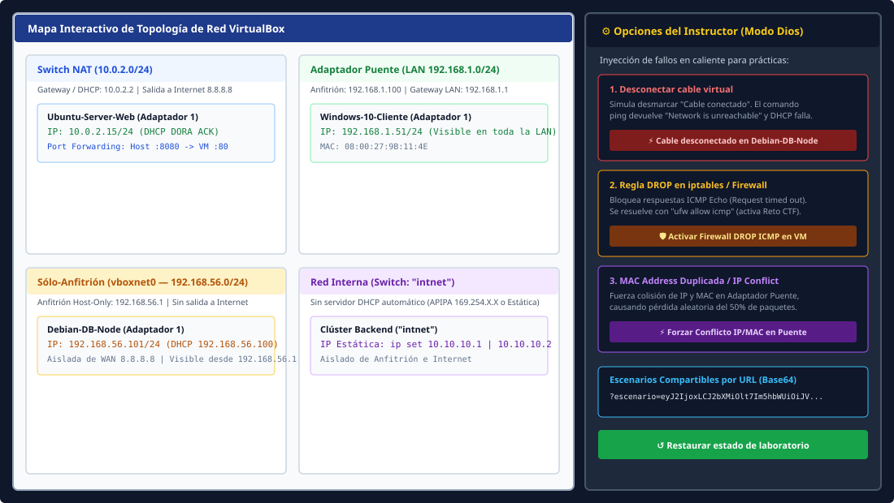

# 🖥️ VirtLab — Simulador Educativo de Redes de Oracle VM VirtualBox


**VirtLab** es un simulador interactivo de escritorio en el navegador que replica fielmente la interfaz clásica del **Administrador de Oracle VM VirtualBox** y su subsistema de redes virtuales. Diseñado para docentes y estudiantes de **Administración de Sistemas, Redes y Ciberseguridad (FP / Universidad)**, permite practicar direccionamiento IP, los 4 modos de red de VirtualBox, negociación DHCP (proceso **DORA**), reenvío de puertos NAT (`Port Forwarding`), diagnóstico con `ping` y `traceroute`, resolución de averías en caliente (**Modo Dios para Instructores**) y retos tipo **Capture The Flag (CTF)** sin necesidad de instalar hipervisores ni consumir gigabytes de RAM.

---

## 📸 Capturas de Pantalla

### 1. Interfaz Clásica del Administrador de Oracle VM VirtualBox
Inventario de máquinas virtuales, barra superior de acciones rápidas, monitor de previsualización en vivo y panel de detalles con el estado de los 4 adaptadores de red:



---

### 2. Configuración de Red (4 Adaptadores) y Reenvío de Puertos NAT
Configuración detallada por adaptador (`NAT`, `Adaptador Puente`, `Red interna`, `Adaptador sólo-anfitrión`) y sub-modal de **Reenvío de Puertos** verificable desde la **Consola del Anfitrión** mediante `curl localhost:[Puerto]`:



---

### 3. Terminal Interactiva (Linux TTY / Windows CMD), Motor DHCP DORA, Traceroute y CTF
Consola interactiva con negociación paso a paso **DORA** (`dhclient` / `ipconfig /renew`), trazado de saltos con `traceroute 8.8.8.8` y validador silencioso de retos **CTF**:



---

### 4. Mapa de Topología en Vivo y Panel del Instructor (Modo Dios)
Diagrama visual de los conmutadores virtuales de VirtualBox y panel lateral para inyectar fallos reales en caliente (**Cable desconectado**, **Firewall DROP ICMP**, **Conflicto de IP / MAC Duplicada**) y exportar el laboratorio en un enlace URL (`?escenario=Base64`):



---

## ✨ Características Principales (Fases 1 a 9 + Mejoras Profesionales)

| Fase / Módulo | Descripción Técnica y Pedagógica |
| :--- | :--- |
| **Fase 1: Interfaz Clásica VirtualBox** | Clon visual de escritorio clásico (`#f0f0f0`), barra de herramientas superior, asistente de creación de VMs (Linux/Windows), clonación de máquinas con política de MAC y persistencia automática en `LocalStorage`. |
| **Fase 2: Modal de Red y Motor de IPs (`NetworkEngine`)** | Simulación de hasta **4 adaptadores de red** por máquina virtual con soporte para **NAT**, **Adaptador Puente**, **Red interna** (`intnet`) y **Adaptador sólo-anfitrión** (`vboxnet0`). |
| **Fase 3: Consola TTY / CMD y Enrutamiento Estricto** | Terminal interactiva diferenciada según el SO (`root@vm:~#` en Linux o `C:\Users\Administrador>` en Windows) con matriz de visibilidad estricta entre VMs, Anfitrión (`192.168.1.100` / `192.168.56.1`) e Internet (`8.8.8.8`). |
| **Fase 4: Panel de Troubleshooting (Modo Dios)** | Cajón extraíble para el docente capaz de inyectar en caliente 3 averías reales: **Desconectar cable virtual**, **Regla DROP en iptables/Firewall** y **MAC Address Duplicada / IP Conflict en Puente**, más botón de restauración. |
| **Fase 5: Escenarios Compartibles por URL (`Base64`)** | Funciones `exportarEscenario()` y `cargarEscenario()` que serializan las VMs, sus adaptadores y las averías activas en `?escenario=[hash_base64]`, permitiendo al profesor enviar un enlace listo para resolver. |
| **Fase 6: Motor DHCP Interactivo (Proceso DORA)** | Al iniciar una VM, los adaptadores DHCP requieren negociación con `dhclient` o `ipconfig /renew`, mostrando en tiempo real `DHCPDISCOVER` ➔ `DHCPOFFER` ➔ `DHCPREQUEST` ➔ `DHCPACK` (o fallo por timeout si el cable está desconectado). |
| **Fase 7: Reenvío de Puertos NAT (`Port Forwarding`)** | Tabla editable de mapeo de puertos en modo NAT y **Consola del Anfitrión** dedicada para probar `curl localhost:[Puerto_Anfitrión]` con respuestas HTTP 200 OK de Apache o `Connection refused`. |
| **Fase 8: `traceroute` / `tracert` Multicapa** | Simulación de saltos lógicos con latencias de `1ms` a `50ms` y retardos de `500ms` por salto según el modo de red (`10.0.2.2` ➔ `192.168.1.1` ➔ `8.8.8.8` en NAT; `192.168.1.1` ➔ `8.8.8.8` en Puente; `* * * Request timed out` en Red interna/Host-Only). |
| **Fase 9: Motor de Retos y Flags (Modo CTF)** | Auditor silencioso en la terminal (`checkCTFWinCondition`) y **Centro de Retos CTF** con 4 desafíos prácticos y entrega de banderas (`flag{v1rtu4l_n3tw0rk_m4st3r}`, etc.). |
| **Extras Educativos Incluidos** | **Mapa Interactivo de Topología de Red**, **Clonación de VMs** (con conservación de MAC para demostrar colisiones ARP), **Importación/Exportación JSON**, y comandos extra: `arp -a`, `netstat -tuln`, `nslookup`, `uname -a`. |

---

## 🌐 Matriz de Visibilidad y Modos de Red de VirtualBox

El motor `NetworkEngine` implementa de forma estricta la tabla oficial de aislamiento y enrutamiento de Oracle VM VirtualBox:

| Modo de Red | Rango IP / Servidor DHCP | VM ➔ VM (Mismo modo) | VM ➔ Anfitrión | Anfitrión ➔ VM | VM ➔ Internet (`8.8.8.8`) |
| :--- | :--- | :---: | :---: | :---: | :---: |
| **NAT** | `10.0.2.15/24` (DHCP `10.0.2.2`) | ❌ Aisladas | ✅ Sí (`192.168.1.100`) | ⚠️ Solo con **Port Forwarding** | ✅ Sí (Gateway `10.0.2.2`) |
| **Adaptador Puente (Bridged)** | `192.168.1.X/24` (DHCP `192.168.1.1`) | ✅ Sí | ✅ Sí (`192.168.1.100`) | ✅ Sí | ✅ Sí (Gateway `192.168.1.1`) |
| **Red Interna (`intnet`)** | Estática manual o APIPA `169.254.X.X/16` | ✅ Solo mismo nombre `intnet` | ❌ No | ❌ No | ❌ No (`* * * Timeout`) |
| **Sólo-Anfitrión (`Host-Only`)** | `192.168.56.X/24` (DHCP `192.168.56.100`) | ✅ Sí | ✅ Sí (`192.168.56.1`) | ✅ Sí (`192.168.56.1`) | ❌ No (`* * * Timeout`) |

---

## 💻 Referencia de Comandos de la Terminal Interactiva

### Comandos en la Consola de la Máquina Virtual (Linux TTY / Windows CMD)

| Comando | Descripción |
| :--- | :--- |
| `ip a` / `ifconfig` / `ipconfig` | Muestra las interfaces de red habilitadas (`eth0`..`eth3`), sus direcciones MAC, estado de enlace (`UP`/`NO-CARRIER`) y dirección IP asignada. |
| `dhclient` / `ipconfig /renew` | Inicia la negociación **DHCP DORA** (`DHCPDISCOVER`, `DHCPOFFER`, `DHCPREQUEST`, `DHCPACK`) con retrasos reales en consola. |
| `ip set [IP] [adaptador]` | Asigna una IP estática manual (imprescindible para laboratorios en **Red interna**, ej. `ip set 10.10.10.1`). |
| `ping [IP]` | Envía 4 paquetes ICMP Echo Request respetando la matriz de visibilidad y las averías activas del panel del instructor. |
| `traceroute [IP]` / `tracert [IP]` | Imprime salto a salto (`500ms` por línea) la ruta de pasarelas hacia el destino con latencias aleatorias (`1ms`–`50ms`). |
| `ufw allow icmp` / `ufw disable` | Desbloquea las reglas `DROP ICMP` del cortafuegos local en la máquina virtual (clave para superar el Reto CTF #1). |
| `arp -a` / `ip neigh` | Muestra la tabla de vecinos ARP alcanzables y alerta si existe una **colisión de dirección MAC duplicada** en Adaptador Puente. |
| `netstat -tuln` / `ss -tuln` | Lista los puertos TCP/UDP en escucha dentro de la VM (`:80 Apache2`, `:22 OpenSSH`) y las reglas de reenvío NAT asociadas. |
| `nslookup [host]` / `dig [host]` | Consulta la resolución DNS hacia `8.8.8.8` comprobando si la VM dispone de salida hacia Internet. |
| `clear` / `cls` / `help` | Limpia la pantalla o muestra la guía completa de comandos disponibles. |

### Comandos en la Consola del Anfitrión (Host Physical Machine)

| Comando | Descripción |
| :--- | :--- |
| `curl localhost:[Puerto]` | Prueba una conexión HTTP contra el puerto local del Anfitrión. Si existe una regla NAT hacia el puerto `80` de una VM encendida, devuelve `HTTP/1.1 200 OK - Apache Server on [VM]`. |
| `ping [IP]` | Comprueba conectividad desde el Anfitrión (`192.168.1.100` / `192.168.56.1`) hacia las VMs en Puente o Sólo-Anfitrión. |
| `traceroute [IP]` / `netstat -tuln` | Traza la ruta desde el Host o lista todos los puertos NAT redirigidos en `127.0.0.1`. |

---

## 🚩 Guía de Retos Capture The Flag (Modo CTF)

Puedes abrir el **Centro de Retos CTF** desde el botón **Retos CTF** de la barra superior o preparar cualquiera de los escenarios con un solo clic:

1. **Reto 1 (Oficial Fase 9) — Maestro del Cortafuegos ICMP**:
   - **Escenario**: Una máquina virtual cargada por URL (`?escenario=...`) o preparada desde el centro de retos tiene el firewall bloqueando ICMP (`Regla DROP en iptables/Firewall`).
   - **Solución**: Abre la consola de la VM, asegúrate de tener IP (`dhclient`), ejecuta `ufw allow icmp` (o desactiva el bloqueo en la UI) y lanza `ping 8.8.8.8`.
   - **Recompensa**: `[+] RETO COMPLETADO. Flag: flag{v1rtu4l_n3tw0rk_m4st3r}`
2. **Reto 2 — Arquitecto NAT Port Forwarding**:
   - **Objetivo**: Configurar un adaptador en modo **NAT**, añadir una regla de reenvío de puertos hacia el puerto invitado `80` (ej. Puerto Anfitrión `8080` ➔ Puerto Invitado `80`) y verificar el servidor Apache desde la **Consola del Anfitrión** con `curl localhost:8080`.
   - **Recompensa**: `flag{n4t_p0rt_f0rw4rd_pr0}`
3. **Reto 3 — Especialista en Aislamiento Red Interna (`intnet`)**:
   - **Objetivo**: Conectar dos VMs a la misma **Red interna** (`intnet`), asignarles IPs estáticas en la misma subred (`ip set 10.10.10.1` y `ip set 10.10.10.2`) y lograr un `ping` exitoso entre ellas.
   - **Recompensa**: `flag{1ntn3t_st4t1c_r0ut1ng_ok}`
4. **Reto 4 — Diagnóstico de Capa Física y Negociación DHCP (DORA)**:
   - **Objetivo**: Diagnosticar una VM con el cable de red desconectado (`Network is unreachable`), reconectar el cable virtual y completar la secuencia `DHCPDISCOVER` ➔ `DHCPACK` con `dhclient` o `ipconfig /renew`.
   - **Recompensa**: `flag{dhc0_d0r4_c4bl3_f1x3d}`

---

## 📂 Estructura del Proyecto

El proyecto está construido en **Vanilla JavaScript (ES6+), HTML5 y CSS3 puros** en la raíz del repositorio para permitir su despliegue directo en **GitHub Pages** o cualquier servidor estático sin pasos obligatorios de compilación:

```text
├── index.html                  # Estructura completa del Administrador VirtualBox, modales y consolas
├── style.css                   # Estilos desktop/skeumórficos clásicos, terminales TTY/CMD y topología
├── app.js                      # Lógica de VirtualMachine, NetworkEngine, DHCP DORA, Traceroute, URL Base64 y CTF
├── docs/
│   └── screenshots/            # Capturas vectoriales de alta definición incluidas en este README
│       ├── 01-main-manager.svg
│       ├── 02-network-settings-port-forwarding.svg
│       ├── 03-console-dhcp-traceroute-ctf.svg
│       └── 04-topology-and-god-mode.svg
└── README.md                   # Documentación completa del proyecto
```

---

## 🚀 Instalación y Despliegue en GitHub Pages

### Opción A: Ejecución directa sin dependencias
Al no requerir backend ni base de datos externa, puedes abrir directamente `index.html` en cualquier navegador moderno o servir la carpeta con cualquier servidor estático:

```bash
# Usando Python 3
python3 -m http.server 8000

# O usando Node.js / Vite incluido en el proyecto
npm install
npm run dev
```

### Opción B: Publicar gratis en GitHub Pages
1. Sube este repositorio a tu cuenta de **GitHub**.
2. Entra en **Settings** ➔ **Pages** dentro de tu repositorio.
3. En **Build and deployment**, selecciona **Deploy from a branch**.
4. Elige la rama `main` (o `master`) y la carpeta `/ (root)`, y pulsa **Save**.
5. En unos segundos tu laboratorio estará disponible en `https://tu-usuario.github.io/tu-repositorio/`, listo para compartir enlaces de práctica con tus alumnos (`?escenario=...`).

---

## 📄 Licencia

Distribuido bajo la licencia **MIT**. Libre para uso educativo, adaptación en aulas de informática y laboratorios de redes.
